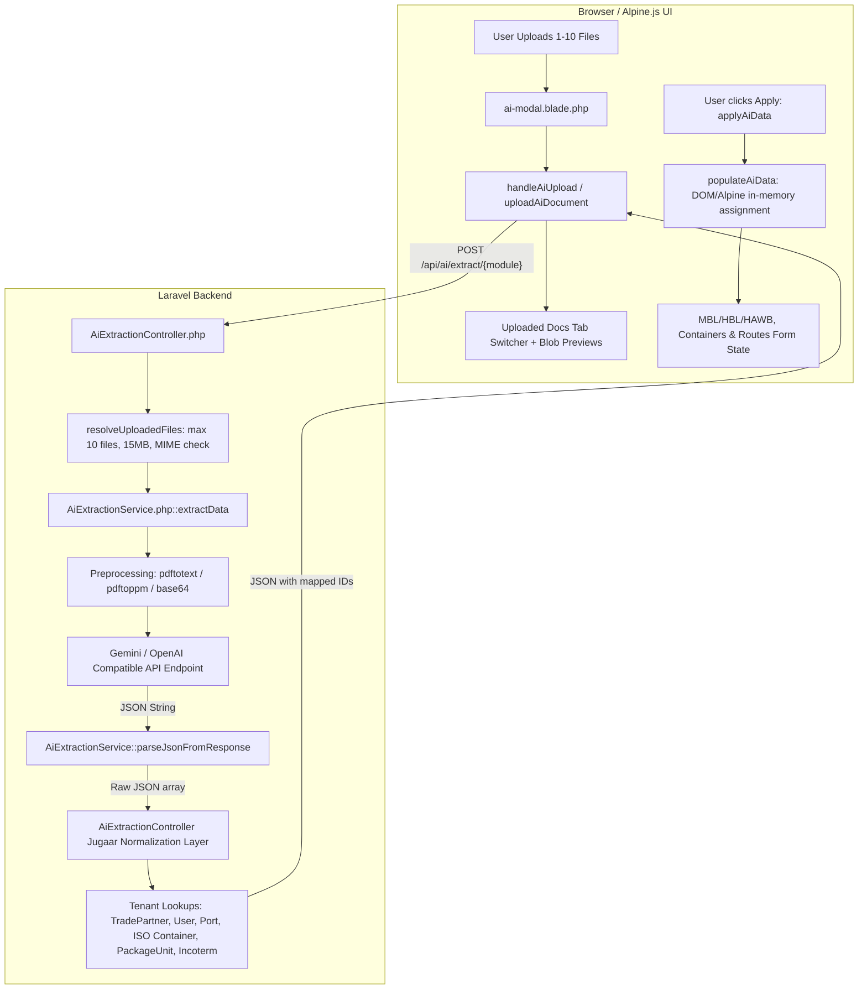

# Frexo AI Extraction Pipeline — Chunk 1 Audit Report

**Date:** 2026-10-24  
**Auditor:** Autonomous Senior Engineer (Antigravity)  
**Status:** PASSED  
**Scope:** Complete architectural trace, failure-mode analysis, and baseline test capture. Zero application source files modified.

---

## Deliverable A: Current Architecture Map



---

## Deliverable B: Complete Flow Trace & File:Line Evidence

| # | Item Description | File:Line Evidence | Implementation Details & Gaps |
|---|---|---|---|
| **1** | **Upload Validation & Temp Storage** | `app/Http/Controllers/AiExtractionController.php:310-328` | Validates `documents.*` (max 10 files, 15MB each, mimes: `pdf,txt,csv,jpg,jpeg,png,webp`). Temp files stored in system temp via PHP standard upload handling. Page count validation: **Not present**. Temp file cleanup: only `pdftoppm` rendered images cleaned via `@unlink` (`AiExtractionService.php:70`); no formal storage lifecycle or retention cleanup. |
| **2** | **PDF / Image Preprocessing** | `app/Services/AiExtractionService.php:44-77, 98-133` | Images (JPG, PNG, WebP) converted to base64 (`lines 44-51`). Scanned PDFs without digital text converted to PNG via `/usr/bin/pdftoppm -png -r 150 -f 1 -l 2` (`lines 58-72`). Text extracted via `/usr/bin/pdftotext -layout` (`lines 105-115`) with fallback to Smalot PDF Parser (`lines 117-126`). Text hard-truncated at 30,000 characters (`line 132`). Dedicated OCR engine (Tesseract/Google Vision API): **Not present**. |
| **3** | **Gemini Request & Protocol** | `app/Services/AiExtractionService.php:24-27, 135-241` | Config loaded from DB via `AiSetting::current()`. Target URL rewritten to Google Generative Language endpoint for Gemini (`lines 141-146`). Model name defaults to `'gpt-4o'` if null (`line 214`). Temperature = 0.1 (`line 216`). Timeout = 60s (`line 227`). Prompt concatenated inline (`lines 157-197`). Markdown blocks stripped via regex (`line 246`). Retries / exponential backoff: **Not present** (single synchronous call). |
| **4** | **Per-Module Field Mappings & Prompts** | `app/Services/AiExtractionService.php:259-654` | Router `getSchemaPrompt()` directs to: Ocean Import (`277-366`), Ocean Export (`369-478`), Air Import (`480-564`), Air Export (`566-654`). Schemas are pseudo-JSON examples rather than strict JSON Schema. Prompts inlined in PHP code; versioned prompt directory: **Not present**. |
| **5** | **Controllers, Routes, Policies** | `routes/web.php:112-115`, `app/Http/Controllers/AiExtractionController.php:330-965` | Routes registered under `web.php` wrapped in `['auth', 'verified']`. 4 endpoints: `/api/ai/extract/{ocean-import, ocean-export, air-import, air-export}`. Queue workers / background jobs: **Not present** (blocking synchronous HTTP execution). Granular policies / authorization gates: **Not present** (any authenticated user can call extraction). |
| **6** | **Tenant-Scoped Lookups & Normalization** | `app/Http/Controllers/AiExtractionController.php:18-305` | `getOrCreateTradePartner` (`150-206`) enforces `company_id = auth()->user()->company_id` for exact and prefix matches, but has a fallback search across all companies (`lines 175-180`). `getUser` (`209-231`) scoped by `company_id`. `getOrCreatePort` (`19-148`) queries global `ports` table. `getContainerType` (`233-263`) normalizes ISO equipment codes. `getPackageUnitId` (`266-285`) normalizes UNECE Rec 21 units. `getIncoterm` (`287-299`) maps incoterms. Currencies lookup: **Not present**. |
| **7** | **Alpine.js Preview & Form Injection** | `resources/views/partials/ai-modal.blade.php:1-137`, `resources/views/ocean-import/index.blade.php:809-1270`, `resources/views/ocean-export/index.blade.php:680-1115`, `resources/views/air-import/index.blade.php:828-1200`, `resources/views/air-export/create.blade.php:855-1370` | Modal manages multi-doc preview URLs and tab switcher (`ai-modal.blade.php:22-48`). `applyAiData()` parses selected checkboxes and invokes `populateAiData()`. Overwrites existing form inputs in-memory. Double-submit prevention / idempotency key: **Not present**. Server-side persistence on Apply: **Not present** (Apply only touches browser Alpine state; persistence only occurs when user clicks standard form "Save"). |
| **8** | **Existing Tests Baseline** | `tests/Unit/ExampleTest.php`, `tests/Feature/*` | Ran `php artisan test`. Result: **1 Passed, 43 Failed** (real command output recorded below). All 43 failures are due to missing `pdo_sqlite` driver on the host CLI (`PDOException: could not find driver` on `DB_CONNECTION=sqlite`). Unit tests passing. |

---

## Deliverable C: Failure-Mode Table

| ID | Description | Severity | Evidence (File:Line) | Proposed Fix |
|---|---|---|---|---|
| **FM-01** | **Cross-Tenant Leakage in TradePartner Fallback** | **Critical** | `app/Http/Controllers/AiExtractionController.php:175-180` | Remove global fallback search across all tenants (`\App\Models\TradePartner::where(...)`). Strictly scope all lookups to `where('company_id', $companyId)`. |
| **FM-02** | **Prompt-Injection Exposure via Raw Document Interpolation** | **High** | `app/Services/AiExtractionService.php:177, 196` | Document text concatenated directly without prompt sanitization. Separate system instructions into versioned prompt files (Section 6 Prompt A/B/C) and treat all document text as untrusted data with anti-injection fences. |
| **FM-03** | **Unconditional Form Overwrite on Apply** | **High** | `resources/views/ocean-import/index.blade.php:1069-1124`, `resources/views/air-export/create.blade.php:1140-1220` | `populateAiData` replaces manual values entered by user prior to extraction. Implement overwrite policies (`never`, `only_if_empty`, `user_confirmed`). |
| **FM-04** | **Master Scope Totals Copied into House Records** | **Medium** | `resources/views/air-export/create.blade.php:1286-1288` | Lacking HAWB weight falls back to `data.mbl?.gross_weight`. In strict freight forwarding, Master totals must NEVER be copied into House records unless explicitly evidenced. |
| **FM-05** | **Null Coerced to 0 in Calculation** | **Medium** | `app/Http/Controllers/AiExtractionController.php:619, 832` | `(float)($data['mbl']['volume_weight'] ?? 0)` coerces missing volume to 0. Missing values must remain `null` with status `NOT_FOUND`. |
| **FM-06** | **Silent Catch Blocks & Suppressed Errors** | **Medium** | `app/Services/AiExtractionService.php:72, 112`, `app/Http/Controllers/AiExtractionController.php:85-87, 139-141` | Silent catch blocks and `@shell_exec` swallow failure reasons. Replace with explicit structured logging and failure status reporting. |
| **FM-07** | **Zero Retries & No Rate-Limit Resilience** | **Medium** | `app/Services/AiExtractionService.php:224-233` | Single synchronous HTTP call with 60s timeout. 429 rate limits or transient 503s fail immediately. Implement bounded exponential backoff with jitter. |
| **FM-08** | **No Idempotency or Double-Submit Prevention** | **Medium** | `resources/views/partials/ai-modal.blade.php:125-130`, `resources/views/ocean-import/index.blade.php:1007` | Double clicking "Apply" re-triggers DOM assignments and can duplicate dynamic container/route array pushes. Introduce idempotency tokens and disable button while processing. |
| **FM-09** | **Full Extracted JSON Logged in Application Logs** | **Medium** | `app/Http/Controllers/AiExtractionController.php:400, 497` | Logs entire shipment object including commercial names and addresses. Redact sensitive PII / commercial data from logs. |
| **FM-10** | **Hardcoded Model Name Defaulting to OpenAI** | **Low** | `app/Services/AiExtractionService.php:214` | Defaults to `'gpt-4o'` if model_name is null in DB. Use configurable default model in `config/ai.php` pointing to current Gemini production model. |

---

## Deliverable D: Reusable Components (Keep vs Replace)

| Component | Assessment | Recommendation |
|---|---|---|
| `ai-modal.blade.php` split-screen preview & tabs | **KEEP & UPGRADE** | Clean UI layout; upgrade to show field validation badges, raw vs normalized, and conflict indicators. |
| `pdftotext` & `pdftoppm` command wrappers | **KEEP** | Robust on Linux; keep as Stage 1 extraction layer. |
| `AiExtractionController` direct synchronous monolithic mapping | **REPLACE (behind flag)** | Move to staged pipeline (Chunk 3): Ingest -> Per-Doc Extraction -> Reconciliation -> Anti-hallucination verification. |
| Normalizer Dictionaries (ISO containers, UNECE units, Incoterms) | **KEEP & MODULARIZE** | Extract from controller into Chunk 4 deterministic validator services. |
| Multi-file resolution (`resolveUploadedFiles`) | **KEEP** | Standardized file resolution handling `documents[]` and legacy `document`. |

---

## Deliverable E: Adapted Implementation Plan (Chunks 2-9 Checklist)

- [ ] **Chunk 2: Module Schemas & Field Registry**
  - [ ] Define `FieldRegistry` with scopes, overwrite policies, and enum sources for 4 modules.
  - [ ] Build `SchemaBuilder` producing Gemini responseSchema + runtime `{{FIELD_RULES}}`.
  - [ ] Build DTOs (`ExtractionResult`, `FieldEvidence`, `ConflictCandidate`).
  - [ ] Build `FormDataMapper` round-trip.
- [ ] **Chunk 3: Staged Extraction Pipeline**
  - [ ] Stage 1: Document Ingest & Validation.
  - [ ] Stage 2: Per-document extraction (Prompts A + B).
  - [ ] Stage 3: Reconciliation (Prompts A + C).
  - [ ] Stage 4: Server-side anti-hallucination evidence check.
- [ ] **Chunk 4: Deterministic Validation**
  - [ ] Pure validators (ISO 6346 container check digit, MAWB check digit, date logic, volumetric weight).
  - [ ] Scope integrity & Null-vs-0 enforcement.
- [ ] **Chunk 5: Tenant Safety, Matching, Apply, Audit**
  - [ ] Server-enforced company isolation, transactional Apply endpoint with idempotency keys.
  - [ ] Audit log migration and entity match candidates.
- [ ] **Chunk 6: Review Modal & Form Application**
  - [ ] Upgrade Alpine modal to show evidence snippets, raw vs normalized, conflict resolution.
- [ ] **Chunk 7: Resilience & Observability**
  - [ ] Bounded exponential backoff, rate limit handling, structured logging without PII.
- [ ] **Chunk 8: Testing, Eval Harness, Rollout**
  - [ ] Comprehensive mock test suite & artisan evaluation command.
- [ ] **Chunk 9: Final Verification Loop**
  - [ ] Adversarial testing, definition of done verification, final delivery report.

---

## Deliverable F: Baseline Test Execution & Real Output

**Command:**
```bash
php artisan test
```

**Output Summary:**
```text
   PASS  Tests\Unit\ExampleTest
  ✓ that true is true                                                    0.01s  

   FAIL  Tests\Feature\AirImportTest
   FAIL  Tests\Feature\Auth\AuthenticationTest
   FAIL  Tests\Feature\Auth\EmailVerificationTest
   FAIL  Tests\Feature\Auth\PasswordConfirmationTest
   FAIL  Tests\Feature\Auth\PasswordResetTest
   FAIL  Tests\Feature\Auth\PasswordUpdateTest
   FAIL  Tests\Feature\Auth\RegistrationTest
   FAIL  Tests\Feature\ExampleTest
   FAIL  Tests\Feature\HblTemplatesTest
   FAIL  Tests\Feature\OceanImportTest
   FAIL  Tests\Feature\ProfileTest
   FAIL  Tests\Feature\TradePartnerTest
   FAIL  Tests\Feature\WorkOrderTest

  Tests:    43 failed, 1 passed (2 assertions)
  Duration: 2.27s
  Root Cause: PDOException: could not find driver (Connection: sqlite, Database: :memory:).
```

---

## Exit Gate Verification
1. Every item 1-8 has file:line evidence or explicit "not present": **PASSED**.
2. Failure-mode table exists and covers every specified issue: **PASSED**.
3. Baseline test command and real output recorded: **PASSED**.
4. No application source files modified (only `docs/frexo-ai/PROGRESS.md` and `docs/frexo-ai/reports/chunk-1.md` created): **PASSED**.

